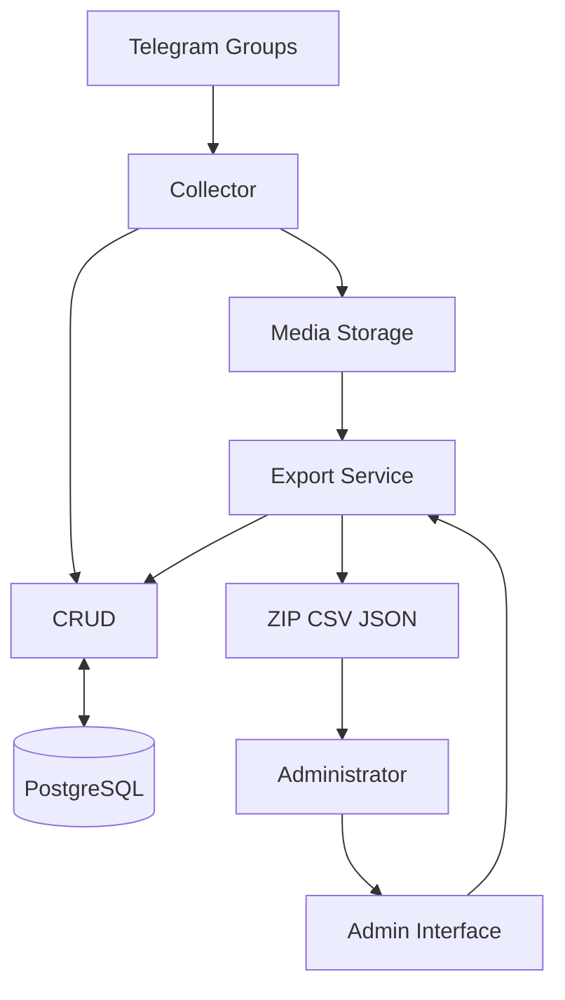
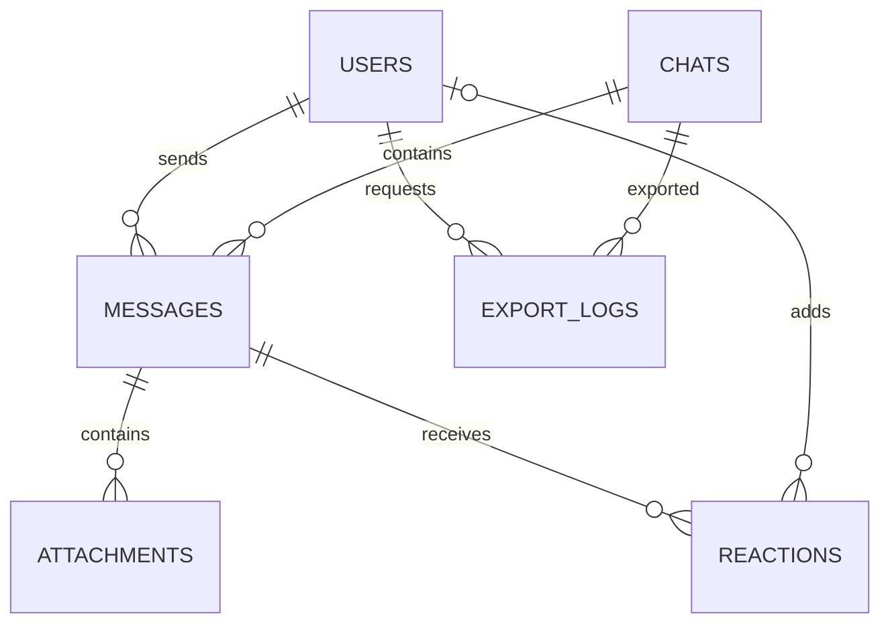

# Архитектура проекта

## 1. Назначение системы

Система автоматического сбора корпоративных переписок
в Telegram с возможностью выгрузки данных за выбранный период.

## 2. Выбор технологии Telegram

Рассмотрены Telegram Bot API и TDLib.

Для реализации выбран Telegram Bot API совместно
с библиотекой Aiogram 3 благодаря простоте интеграции
и отсутствию необходимости авторизации личного аккаунта.

Ограничения:
- Получение сообщений после подключения бота.
- Для получения реакций необходимы права администратора.
- Ограничения размера скачиваемых и отправляемых файлов.

## 3. Архитектура приложения

## 4. Модули приложения

- config.py — загрузка параметров окружения.
- main.py — запуск и объединение модулей.
- collector.py — получение сообщений и реакций.
- admin.py — интерфейс администратора.
- db.py — подключение к PostgreSQL.
- models.py — модели базы данных.
- crud.py — операции с данными.
- media.py — сохранение вложений.
- export.py — формирование архивов.
- export_ui.py — интерактивный интерфейс выбора чата,
  периода и подтверждения выгрузки с использованием FSM.

## 5. Структура базы данных

## 6. Безопасность

- Сбор данных только из разрешённых групп.
- Уведомление участников о сборе сообщений.
- Выгрузка только авторизованными администраторами.
- Хранение секретных параметров в .env.
- Исключение переписок и файлов из GitHub.
- Проверка путей к вложениям.
- Защита CSV от внедрения формул.

## 7. Тестирование

Для автоматического тестирования используется Pytest.
Отдельно проверяются база данных, права доступа,
реакции, обработка дат и формирование архивов.